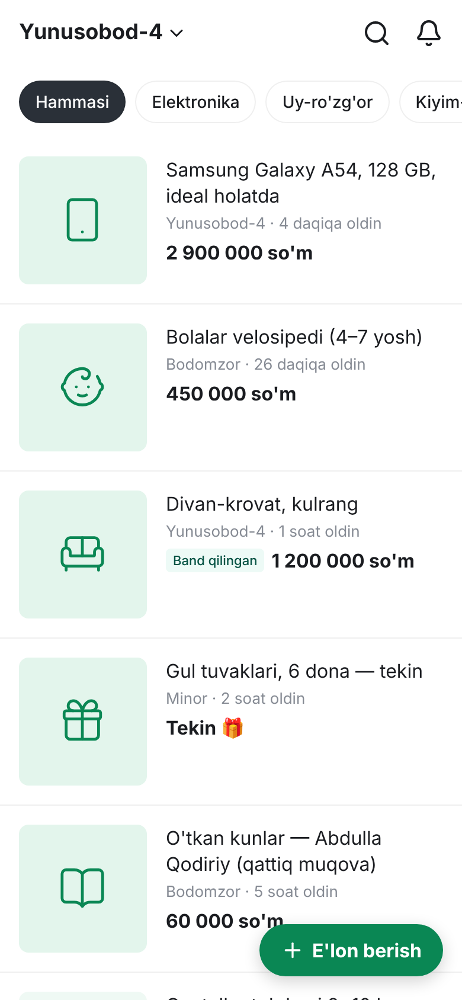
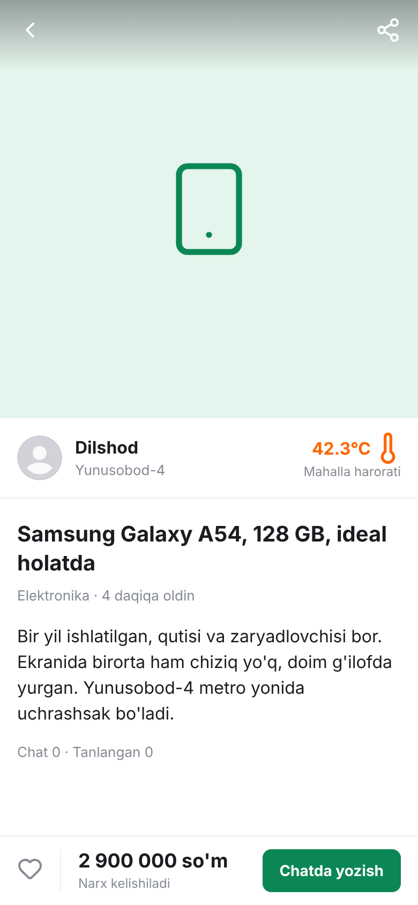
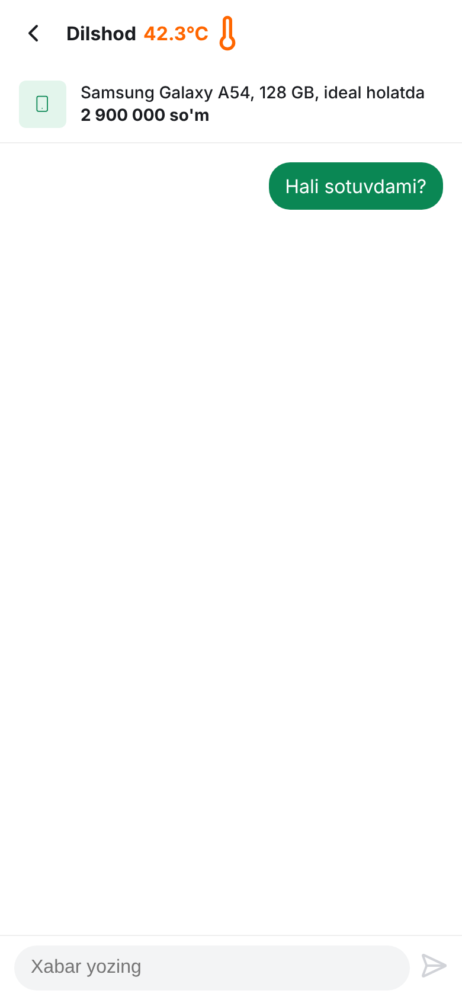
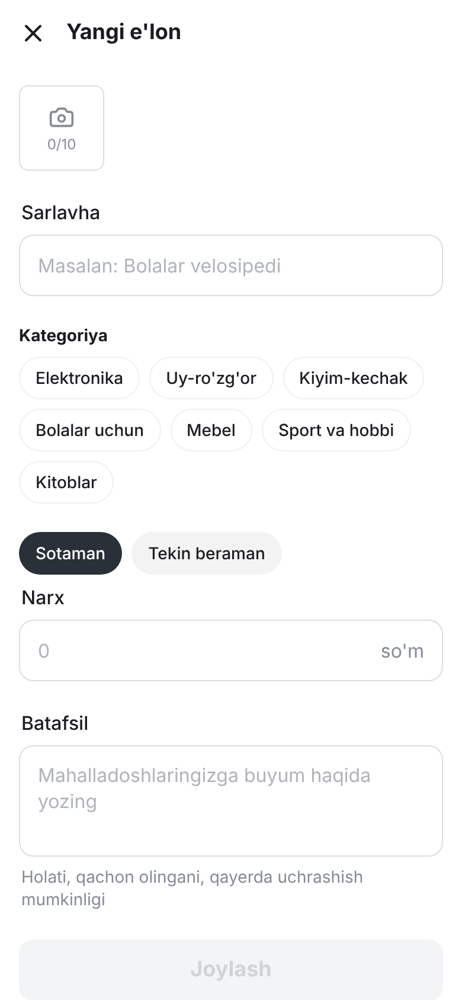

# MahallaMarket (mm.uz)

Koreyaning Daangn (Karrot) platformasining o'zbekcha analogi — mahalla asosidagi hyperlocal e'lonlar platformasi.

## Tez boshlash
```bash
# Node.js 22+ kerak (.nvmrc)
docker compose up -d postgres redis minio
cd apps/api && copy .env.example .env      # Linux/Mac: cp
npm install
npm run db:migrate          # jadvallarni yaratadi
npm run db:seed:demo        # hududlar, kategoriyalar + namunaviy e'lonlar
npm run start:dev
cd apps/web && npm install && npm run dev
cd apps/app && npm install && npm run dev
```
- API: http://localhost:4000/api, Swagger: http://localhost:4000/docs
- Web (SEO sahifalar, Next.js): http://localhost:3000
- **Ilova (mobil tajriba, Stackflow + SEED):** http://localhost:5173 — telefon o'lchamida oching

| Lenta | E'lon | Chat | Yangi e'lon |
|---|---|---|---|
|  |  |  |  |

## Hujjatlar
- [Mahsulot spetsifikatsiyasi](docs/01-product.md)
- [Arxitektura va DevOps](docs/02-architecture.md)
- [Keyingi qadamlar](docs/03-next-steps.md)
- [Daangn GitHub tahlili](docs/04-daangn-github-tahlili.md)
- [Hududlar (viloyat/tuman/MFY) va import](docs/05-hududlar.md)
- [API endpointlar](docs/06-api.md)
